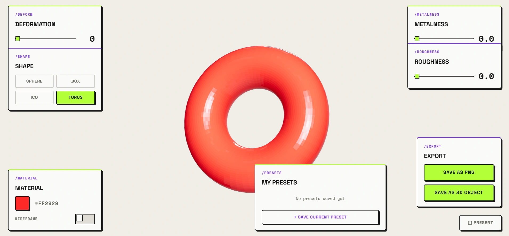

# 3D Object Editor

**Shape, deform and export 3D objects right in your browser.**



**[Live demo](https://3d-object-editor-iota.vercel.app/)** 

## The idea

Most 3D tools ask you to install heavy software before you can see anything. This project explores the opposite: a lightweight editor that runs in the browser, where you pick a shape, push it into something organic, tweak its material and see the result instantly.

It started as a single sphere and a handful of properties to experiment with. It grew into a small real-time editor for procedural shapes, built to understand how a modern WebGL pipeline works, from React state all the way down to the GPU.

## What you can do

- **Pick a base shape:** sphere, box, icosahedron or torus.
- **Deform it:** noise-driven displacement turns clean primitives into organic forms. Move your cursor and the pattern shifts with it.
- **Tune the material:** color, metalness, roughness and wireframe, lit by an HDR studio environment.
- **Save presets:** keep your favorite configurations in the browser and reload them with one click.
- **Export:** download a PNG snapshot or the mesh as a glTF file.
- **Present:** hide the interface to show the object on its own. On mobile, the controls collapse into a drawer.

## What it's for

- Rapid prototyping of abstract shapes and visual ideas.
- Exploring how materials react to light.
- Creating base meshes to continue in Blender or in game engines. glTF is supported by Blender, and by Unity and Unreal Engine through their glTF importers.
- Learning: a compact, readable example of React Three Fiber, custom shaders and global state working together.

> **Note:** the exported file contains the shape's base geometry. Baking the shader deformation into it is on the roadmap.

## How it works

Deformation runs on the GPU. A custom vertex shader, injected into three.js's physically based material through [three-custom-shader-material](https://github.com/FarazzShaikh/THREE-CustomShaderMaterial), displaces every vertex along its normal using 3D simplex noise. React only updates a few uniforms per frame (time, deformation level and mouse position) and the GPU does the rest, in parallel for all vertices. Because the standard material is preserved, lighting, metalness and roughness keep working as usual.

A single Zustand store connects the interface with the scene: controls write to it and the 3D object reads from it. Presets are persisted in `localStorage`.

**Stack:** React 19, TypeScript, Vite, three.js, React Three Fiber, Drei, Zustand, GLSL.

## Run it locally

```bash
git clone https://github.com/EmiLzLz/3d---Object-Editor.git
cd 3d---Object-Editor
npm install
npm run dev
```

## Where it's going

This editor is a first step towards a broader goal: building immersive web experiences that go beyond traditional pages, and connecting the web with tools like Blender, Unity and Unreal Engine. Next up:

- [ ] Bake the shader deformation into exported models
- [ ] Visual shape selector with live previews
- [ ] Self-hosted HDR environment (no CDN dependency)

## Credits

Simplex noise by Ian McEwan, Ashima Arts (MIT License). Shader fundamentals learned from [The Book of Shaders](https://thebookofshaders.com/).
